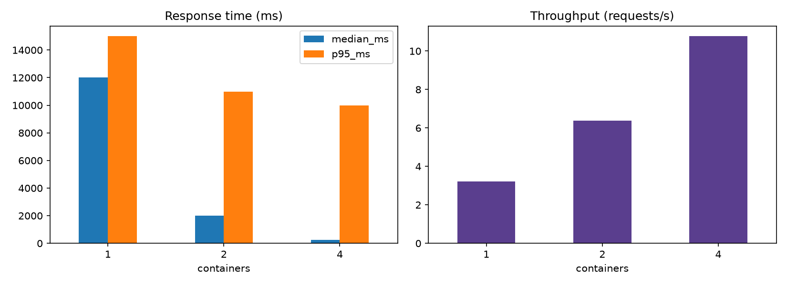

# Malaria Cell Classifier

A retrainable image classification pipeline that tells whether a blood cell image is **parasitized** or **uninfected**. It covers the full machine learning cycle: data acquisition, preprocessing, model training, evaluation, an API, a web UI, retraining on newly uploaded data, containerised deployment and load testing.

- **Dataset:** NIH National Library of Medicine malaria cell images (27,558 images, two balanced classes).
- **Final model:** MobileNetV2 (ImageNet weights, fully fine-tuned, 128x128 input).
- **Backend:** FastAPI, served by several Docker containers behind an nginx load balancer.
- **Frontend:** plain HTML, CSS and JavaScript in `frontend/`.
- **Live API:** https://machine-learning-cycle-zn31.onrender.com (free tier, the first request after idle can take about a minute)
- **Demo video:** [Video Demo](https://youtu.be/A8_dBo4I1dY)
- **Github repo:** [Github Repo](https://github.com/KelvinAaron/Machine-Learning-Cycle.git)

## What the app does

| Feature | Where |
|---|---|
| Predict one cell image | Predict tab, `POST /predict` |
| Data visualisations (class balance, colour channels, stain fraction) and model metrics | Dashboard tab |
| Model uptime and request latency | Dashboard tab, `GET /health`, `GET /status` |
| Bulk upload of labelled images | Data and retraining tab, `POST /upload` |
| Retrain on uploaded data (button, or automatic at 50 new images) | Data and retraining tab, `POST /retrain` |

## Setup

### 1. Run with Docker (recommended)

Requires Docker Desktop. To run 4 containers, give it at least 4 CPUs and 4 GB of memory.

```
git clone https://github.com/KelvinAaron/Machine-Learning-Cycle.git
cd Machine-Learning-Cycle
docker compose up --build --scale api=2
```

Wait until `docker compose ps` shows the API containers as healthy, then open http://localhost:8080/health. Refresh a few times and the `instance` value changes as nginx spreads requests across containers. The first build downloads TensorFlow and takes a few minutes.

Models and data live in Docker volumes, so retrained models and uploads survive restarts. To reset everything back to the files in the repo, run `docker compose down -v`.

### 2. Open the UI

Edit `frontend/config.js` and set `API_BASE_URL` to where the API is reachable:

| Where the API runs | `API_BASE_URL` |
|---|---|
| Docker with nginx | `http://localhost:8080` |
| Render | `https://machine-learning-cycle-zn31.onrender.com` |

Then open `frontend/index.html` in a browser.

### 3. Retrain the model from scratch (notebook)

The notebook was run on Google Colab with a GPU runtime. Upload the repository as a zip in the first cell, run it from top to bottom, and download the exported `models/` folder at the end. It downloads the full dataset itself, splits it 80/20 with a fixed seed, trains three models, tunes MobileNetV2, evaluates all of them on the test set, and registers the best one by validation F1.

### 4. Try retraining in the app

Upload at least 50 labelled images (for example from `data/train`), choosing the label that matches each image. Retraining starts automatically at 50 images, or press **Retrain model**. The new version is promoted only if its F1 and recall are within 0.005 of the live model on the same test set. The Dashboard tab lists every version and whether it was promoted or rejected.

### 5. Evaluate the deployed model

```
python src/evaluate_production.py --url https://machine-learning-cycle-zn31.onrender.com --per-class 50
```

This sends labelled test images to the live `/predict` endpoint and writes accuracy, precision, recall, F1, ROC-AUC, the confusion matrix and latency to `production_evaluation.json`.

### 6. Load test with Locust

Run the same test against 1, 2 and 4 containers. In PowerShell, from the repository root:

```
docker compose up --build --scale api=1 -d
locust -f load_test/locustfile.py --host http://localhost:8080 --users 40 --spawn-rate 5 --run-time 2m --headless --csv load_test/results/containers_1 --html load_test/results/containers_1.html
docker compose down
```

Repeat with `--scale api=2` and `--scale api=4`, changing `containers_1` to `containers_2` and `containers_4`. Then run `python load_test/summarize.py` to produce `summary.csv` and `summary.png`. Each container is limited to one CPU in `docker-compose.yml`, so adding containers adds capacity.

The test used 40 simulated users for 2 minutes per run. Throughput rose from 3.21 requests per second with one container to 6.37 with two and 10.77 with four, about 2.0 and 3.4 times the single-container rate, with no failed requests. The median response time fell from 12.0 seconds to 2.0 seconds and then 0.24 seconds, because requests wait in a much shorter queue once more containers share the work. The 95th percentile improved far less (15, 11 and 10 seconds), which suggests that even four containers were still saturated by 40 users. Scaling at four containers was slightly below linear, most likely because the containers, nginx and Locust all ran on the same machine.




## Known limitations

- The Render free tier has 512 MB of memory and 0.1 CPU. It serves predictions (about 1.1 seconds each) but ran out of memory when retraining, so retraining is demonstrated on the local Docker setup.
- Files written at runtime on Render (uploads, retrained models) are lost when the instance restarts, and the service goes back to model version 1.